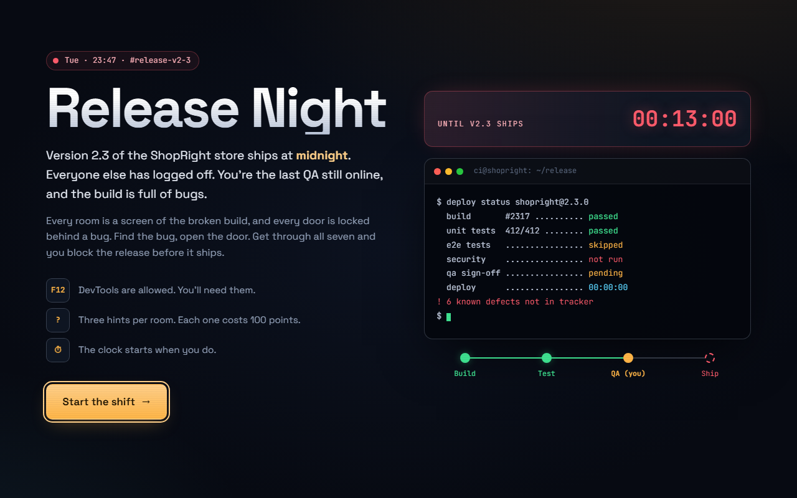
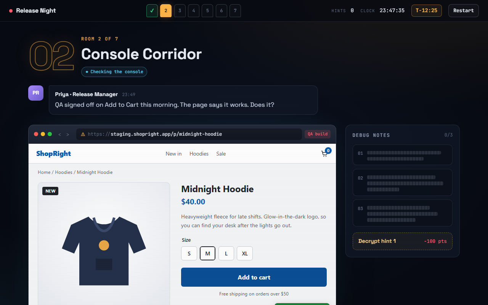
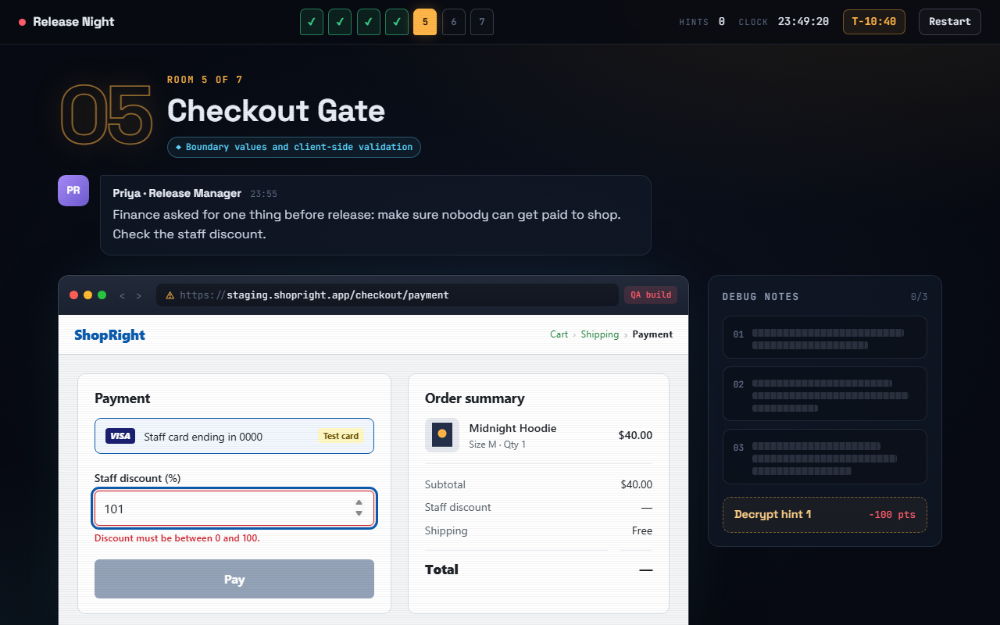
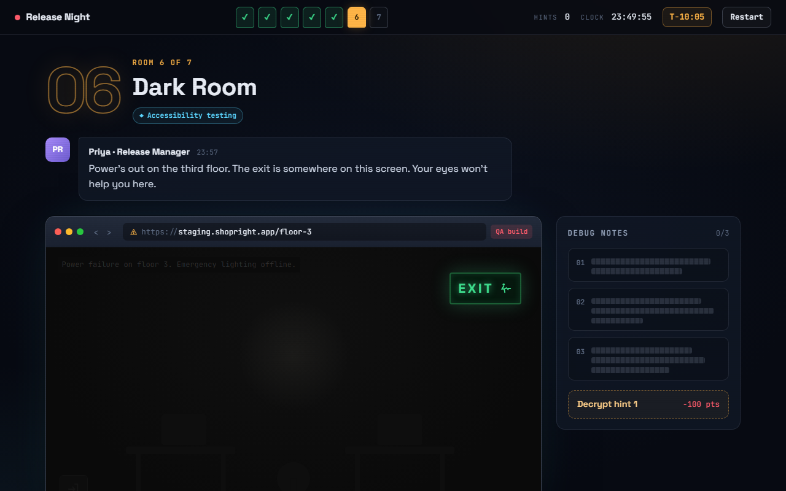
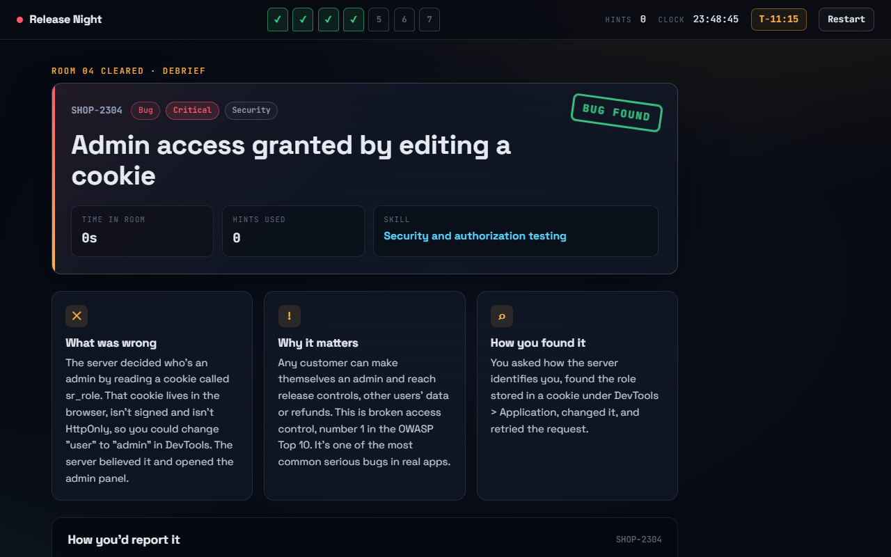
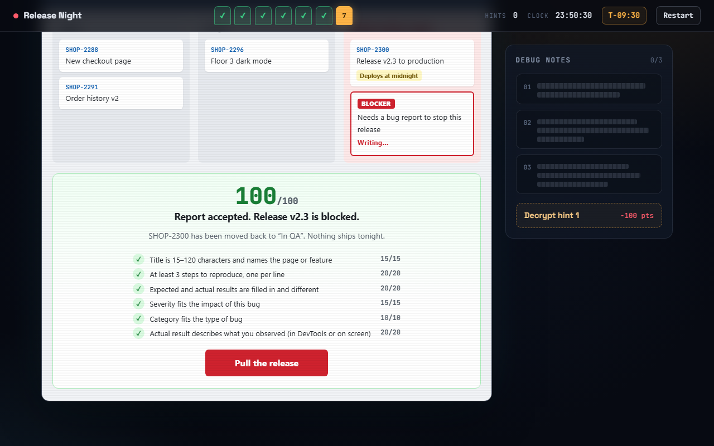
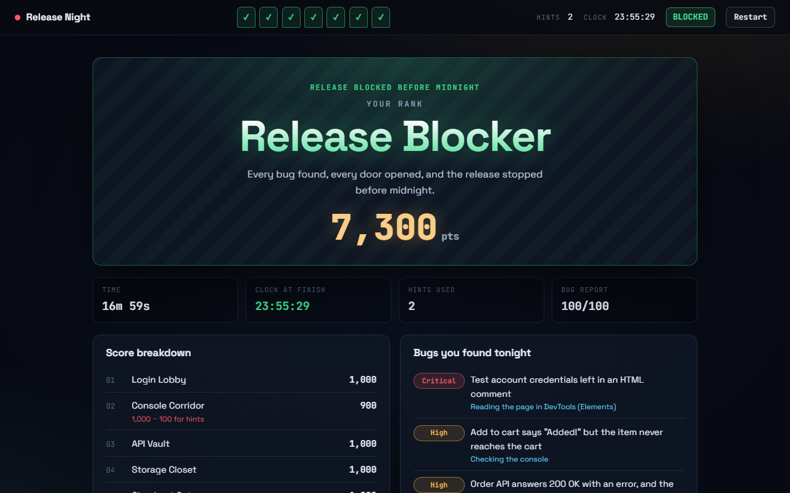

# Release Night: a QA escape room

[](https://github.com/hhaiel/release-night-qa-game/actions/workflows/ci.yml)

> It's 23:47 and v2.3 of the ShopRight store ships at midnight. You're the last QA still online. Every door is locked behind a bug. Find the bug, open the door, block the release.

<!-- LIVE_LINK -->

A browser game where each room is a screen of a broken web store, and each door is locked behind a real-world bug. You find the bugs with the same tools a tester uses every day: DevTools, the console, the Network tab, cookies, the keyboard and a screen reader's view of the page. After each room, a debrief explains the bug the way it would show up on a real project, including a ready-to-file bug report.

It's also a **QA project in its own right**: the game is tested with a test plan, 56 manual test cases, 76 automated Playwright tests (UI, API and accessibility) running in CI, and a defect log of real bugs found in the game itself.



## At a glance

| | |
|---|---|
| **What it is** | A 7-room QA escape-room game, playable in the browser |
| **Skills it teaches** | Reading the DOM, console checking, API testing, authorization testing, boundary values, accessibility testing, defect reporting |
| **Tech** | React, TypeScript, Vite; serverless API (Vercel Functions) |
| **Testing** | Playwright (UI, API), axe-core (WCAG 2.1 AA), Page Object Model, GitHub Actions |
| **Test docs** | [Test plan](docs/test-plan.md) · [test cases](test-cases/) · [defect log](defects/defect-log.md) |

## Results summary

| Metric | Value |
|---|---|
| Rooms | 7, each with a deliberate bug, 3 hints and a debrief |
| Manual test cases | 56 (game shell 8, rooms 19, API 20, accessibility 9) |
| Automated tests | **76 passing** in CI (UI 27, API 40, accessibility 9), about 45 s |
| Defects found in the game | **10** (5 Medium, 5 Low): 8 fixed and retested, 2 open |
| Found by automation on its first run | 4 (3 accessibility, 1 ending screen) |

**Top findings** (real bugs in the game, not the deliberate ones):
1. **DEF-006:** my own accessibility fix broke a different accessibility rule (WCAG 2.5.3). The hint button's label no longer matched its visible text. axe caught the regression on 6 screens.
2. **DEF-004:** door codes typed with spaces instead of dashes were rejected, so a player with the right answer got stuck.
3. **DEF-008:** screen readers couldn't hear the final score. The walkthrough test caught it: the score was right, but its accessible name was empty.

## The rooms

<details>
<summary><strong>Spoilers:</strong> the seven bugs and how you find them</summary>

| # | Room | The bug | How you find it | QA skill |
|---|---|---|---|---|
| 1 | Login Lobby | A developer left a test account in an HTML comment | DevTools > Elements | Reading the page source |
| 2 | Console Corridor | "Added to cart!" shows, but the cart stays empty | The console logs a TypeError and a trace ID | Checking the console |
| 3 | API Vault | Order history says "No orders yet" | The API answers 200 OK with an error (and debug data) in the body | Network tab, API testing |
| 4 | Storage Closet | The admin panel trusts a `role=user` cookie | Change the cookie to `admin` | Authorization testing |
| 5 | Checkout Gate | The browser blocks a 101% discount, the server doesn't | Remove the browser-only limit, or resend the request | Boundary values, client-side validation |
| 6 | Dark Room | The only exit has no name, no contrast and no focus outline | Tab to it; read the hidden live region | Accessibility testing |
| 7 | The Release Board | You need a bug report good enough to stop the release | The server scores your report out of 100 | Defect reporting |

Full design, answers and API contract: [docs/game-design.md](docs/game-design.md).
</details>

| Room 2: the page says success | Room 5: only the browser says no |
|---|---|
|  |  |
| **Room 6: the power's out** | **After each room: the debrief** |
|  |  |
| **Room 7: write the bug report** | **The ending** |
|  |  |

## How it's built

- **The game:** React + TypeScript on Vite. Each room is one file in [`src/rooms/`](src/rooms/) with its page, three hints and a debrief, so a new room doesn't touch the rest of the game. Progress is saved in `localStorage`.
- **Answers are checked on the server** ([`api/check.ts`](api/check.ts)), and the repo stores only SHA-256 hashes of them. Reading the game's JavaScript or this repo doesn't give the answers away. Room 1 is the one exception: finding the login in the page *is* the puzzle. CI fails the build if a room answer turns up in the client bundle.
- **Rooms 3–5 have real API endpoints** that are broken on purpose: a 200 OK carrying an error, a role trusted from a cookie, a discount with no server-side limit. The same functions run on Vercel and locally (a small Vite plugin in [`vite.config.ts`](vite.config.ts)).
- **Room 7's judge** ([`api/_lib/report-rules.ts`](api/_lib/report-rules.ts)) scores bug reports on six checks: title, steps, expected vs. actual, severity, category and evidence. It explains every point you lose.

## How it's tested

| Layer | What | Where |
|---|---|---|
| UI | Every room solved the way a player would: reading DOM comments, listening to the console, reading network responses, editing cookies, removing HTML attributes, pressing Tab and Enter | [`tests/ui/`](tests/ui/) |
| Walkthrough | The whole game with no hints must end as "Release Blocker" with exactly 7,500 points | [`walkthrough.spec.ts`](tests/ui/walkthrough.spec.ts) |
| API | The answer checker's contract, plus every room endpoint, with table-driven boundaries (discount −1, 0, 1, 12.5, 99, 100, **101**, 150, "50", null) | [`tests/api/`](tests/api/) |
| Accessibility | axe-core against WCAG 2.1 AA on every screen. Room 6 must fail with **exactly** its two intended violations | [`tests/a11y/`](tests/a11y/) |
| CI | Typecheck, build, answer-leak check, all 76 tests, HTML report as an artifact, on every push | [`.github/workflows/ci.yml`](.github/workflows/ci.yml) |

**A twist on regression testing:** the deliberate bugs are *pinned* by tests. If someone "fixes" Room 5's discount check by accident, the build fails, because the puzzle depends on the bug.

**Conventions** (same as my OrangeHRM QA project):
- Test titles start with the manual test case ID, so each automated test traces to a written case.
- All locators live in one Page Object ([`tests/support/game-page.ts`](tests/support/game-page.ts)) and use `getByRole` / `getByLabel` first.
- No fixed waits: assertions retry until they pass.
- Tests can run against the live site: `BASE_URL=<url> npm test`.

## What I learned

- **Fixes need testing too.** I improved the hint button for screen readers and broke a different WCAG rule (DEF-006). It only surfaced when axe ran on every screen.
- **Automated accessibility tools have blind spots.** axe can't measure contrast on gradients, so the Dark Room's intended contrast bug was invisible to it at first (DEF-009). Knowing what a tool *can't* see matters as much as what it reports.
- **Flaky tests usually point at a real cause.** Tests that failed differently on each run came down to endless CSS animations slowing axe under load. Running with the browser's reduced-motion setting, which the game already supported, fixed it. So did removing a race in my own test helper (DEF-010), rather than adding retries.
- **Designing a bug is harder than finding one.** Each deliberate bug had to be realistic, findable with standard tools, and impossible to shortcut. For example, the Room 2 code is built from character codes so searching the bundle doesn't find it.

## Run it locally

```bash
npm install
npm run dev                       # http://localhost:5173 (open DevTools, you'll need them)
```

Tests:

```bash
npx playwright install chromium   # first time only
npm test                          # everything; starts its own server on port 4174
npm run test:ui                   # or test:api, test:a11y
npm run test:report               # open the last HTML report
BASE_URL=https://<deployment> npm test   # run against a deployed copy
```

## Project layout

```
.github/workflows/   CI: typecheck, build, answer-leak check, Playwright
api/                 serverless endpoints: answer check and the room APIs
  _lib/              hashed answers, report scoring rules, cookie helper
defects/             defect log
docs/                game design (spoilers), test plan, screenshots
scripts/             hash-answer, screenshots
src/
  components/        game shell: intro, top bar, hints, door, debrief, ending
  game/              room registry, saved progress, scoring
  rooms/             one file per room: page + hints + debrief
test-cases/          56 manual test cases (IDs match the automated tests)
tests/
  support/           Page Object and fixtures
  ui/ api/ a11y/     Playwright specs
```
